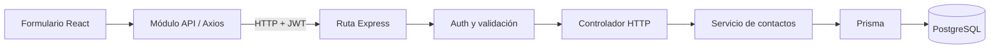

# Guía para exponer órbita CRM

## La idea en una frase

> «Órbita es un CRM de contactos: reúne los datos de personas y empresas y permite seguir la relación comercial desde prospecto hasta cliente. Cada usuario administra su propia información. La interfaz usa React, la API Express y los datos se guardan en PostgreSQL.»

**CRM** describe el propósito: gestionar relaciones con clientes. **CRUD** describe las operaciones de crear, leer, actualizar y eliminar que usa el CRM.

El alcance es pequeño a propósito: contactos, notas y tres estados. Esa elección permite seguir una operación completa y explicar cómo se validan los datos, se controla el acceso y se guarda la información.

## Preparación antes de presentar

- Seguí el [README](../README.md) y verificá login, contactos y Swagger.
- Prepará las pestañas de interfaz, Swagger, repositorio y ejecución de CI. Abrí las URLs de producción cuando estén verificadas.
- Tené a mano `schema.prisma`, las rutas de contactos, el middleware de autorización, el controlador, el servicio y un test de integración.
- Usá un contacto ficticio para la demo: **Lucía Demo**, **Estudio Sur**, `lucia.demo@example.com`.
- Conservá commits y checkpoints reales de la cursada. Un único commit final no demuestra por sí solo lo desarrollado en las semanas 7 a 13.
- Ensayá crear, cambiar estado, recargar y eliminar. No pruebes por primera vez una función durante la defensa.

## Recorrido de siete minutos

### 0:00–0:40 · Problema y alcance

> «Un negocio necesita recordar quién es cada contacto, en qué empresa trabaja y cómo viene la conversación. Este CRM lo organiza en tres estados: prospecto, en seguimiento y cliente. Partí del login del primer parcial y agregué la gestión de contactos con persistencia real.»

Señalá los indicadores y la lista. Aclarar qué decidiste implementar ayuda a mostrar que dimensionaste el proyecto.

### 0:40–2:15 · Demostración funcional

1. Creá a Lucía Demo como prospecto y agregá una nota. Explicá: «El formulario envía un `POST` y la API valida y guarda».
2. Buscá «Lucia», incluso sin tilde. Mostrá que encuentra el contacto.
3. Abrí su ficha, cambiá a **En seguimiento** y editá la nota. Explicá: «La actualización viaja con `PUT`».
4. Filtrá por ese estado y recargá. Mostrá que el contacto y la sesión siguen disponibles.
5. Eliminá únicamente el contacto de demo, pasando por la confirmación. Explicá: «La API recibe un `DELETE`».

Si la defensa permite más tiempo, ingresá con una segunda cuenta para mostrar una lista diferente. La prueba automatizada de autorización también cubre ese caso.

### 2:15–3:15 · Seguir una operación entre capas

Mostrá el caso «crear contacto»:

> «React recoge los campos. El módulo API usa Axios para hacer el pedido HTTP. Express encuentra la ruta; los middlewares verifican el JWT y validan el cuerpo con Zod. El controlador se ocupa de la respuesta HTTP y el servicio realiza la operación con Prisma. PostgreSQL guarda el registro. La API devuelve JSON y React actualiza la lista.»



La separación permite cambiar la interfaz sin mover consultas SQL al navegador y probar las reglas sin depender de cada pantalla.

### 3:15–4:05 · Seguridad con un ejemplo concreto

> «Autenticar es saber quién hace el pedido. Autorizar es decidir a qué datos puede acceder. El token identifica al usuario y el backend exige que el contacto le pertenezca. Aunque alguien conozca un ID ajeno, no puede usarlo. Zod descarta campos como `userId`, que solo administra el servidor.»

Nombrá dos controles adicionales: bcrypt para contraseñas y límite de intentos para el acceso. Mostrá el test de acceso ajeno.

> «Relacioné estos controles con OWASP. No digo que la aplicación sea inmune a ataques: el JWT actual está en localStorage y un XSS podría leerlo. Una mejora sería una cookie HttpOnly con la protección CSRF correspondiente.»

Más detalle: [SEGURIDAD.md](SEGURIDAD.md).

### 4:05–4:55 · Testing y CI

Mostrá un test unitario y uno de integración:

> «Con Jest pruebo reglas pequeñas y componentes. La integración pasa por HTTP, Express y PostgreSQL: crea datos temporales, recorre las operaciones y comprueba que una cuenta no use los contactos de otra. La pirámide combina muchas verificaciones rápidas con menos pruebas completas, que son más costosas.»

Mostrá el workflow y, cuando exista, un run remoto verde:

> «GitHub Actions prepara una base temporal, aplica migraciones, ejecuta las pruebas y compila ambos proyectos. Así cada cambio vuelve a pasar por los mismos controles.»

No presentes un archivo YAML como si fuera una ejecución: el enlace al run es la evidencia de CI. Más detalle: [TESTING.md](TESTING.md).

### 4:55–5:30 · Swagger/OpenAPI

Abrí `/api/docs`:

> «OpenAPI es el contrato: describe rutas, campos, seguridad y respuestas. Swagger UI muestra ese contrato y permite probar pedidos. Documento también los errores, por ejemplo `400`, `401` y `404`.»

Podés ejecutar login, copiar el token de respuesta, ingresarlo en **Authorize** y consultar contactos. No muestres secretos del servidor. El token de una cuenta de demostración permite actuar como esa cuenta, así que usá datos ficticios.

### 5:30–6:15 · N+1 e índices

> «N+1 sería pedir una lista y luego hacer una consulta por cada fila. El listado actual usa una sola consulta, filtrada por dueño; no hay búsquedas dentro de un bucle. Lo verifiqué contando SQL. También ejecuté EXPLAIN ANALYZE y el plan utilizó el índice de userId.»

> «La base de demo tiene seis contactos. Esa medición no permite prometer rendimiento de producción. Si creciera, mediría con más datos y consideraría paginación e índices según las consultas.»

Más detalle y comando reproducible: [PERFORMANCE.md](PERFORMANCE.md).

### 6:15–7:00 · Producción, límites y ampliación

Si el despliegue está verificado, abrí las URLs HTTPS del frontend y backend y mostrá un dato que persista. Si falta, identificá ese pendiente: la configuración lista no equivale a un despliegue realizado.

> «En producción los secretos van en variables privadas del proveedor; el navegador solo conoce la URL pública de la API. Las migraciones se aplican sobre la base publicada. Como ampliación optativa se podría usar n8n para preparar recordatorios de seguimiento, consumiendo esta API, sin agregar esa complejidad al núcleo del parcial.»

## Pantallas y métodos HTTP

| Acción                           | Pedido o comportamiento                                              |
| -------------------------------- | -------------------------------------------------------------------- |
| Crear cuenta                     | `POST /api/auth/register`                                            |
| Iniciar sesión                   | `POST /api/auth/login`                                               |
| Restaurar sesión                 | `GET /api/auth/me`                                                   |
| Cargar contactos                 | `GET /api/customers`                                                 |
| Consultar un contacto por API    | `GET /api/customers/:id`                                             |
| Crear un contacto                | `POST /api/customers`                                                |
| Editar datos o cambiar el estado | `PUT /api/customers/:id`                                             |
| Eliminar un contacto             | `DELETE /api/customers/:id`                                          |
| Buscar, filtrar y ordenar        | React organiza la lista ya cargada                                   |
| Abrir ficha                      | Usa los datos del listado; la API también ofrece consulta individual |

## Modelo y decisiones que conviene entender

`User` tiene muchos `Customer`; cada contacto tiene un solo dueño. `id` identifica el contacto y `userId` define su pertenencia. `createdAt` y `updatedAt` los administra la base/ORM.

`name` y `email` son obligatorios. `company`, `phone` y `notes` son opcionales. El enum `status` admite `PROSPECT`, `FOLLOW_UP` y `CLIENT`; evita guardar estados arbitrarios como «casi cliente quizás».

La tabla `items` pertenece a la versión previa y se conserva para no borrar información. La entidad que se presenta como CRM es `Customer`.

## Preguntas probables del profesor

### ¿Un JWT cifra los datos?

No. En este proyecto firma los claims para detectar cambios y verificar quién lo emitió, su destinatario y vencimiento. Su contenido se puede leer; por eso no lleva contraseñas ni notas de clientes. HTTPS protege el transporte.

### ¿CORS impide que alguien use Postman?

No. Es una política para navegadores. Las rutas privadas necesitan el JWT y autorización por dueño aunque el pedido no tenga `Origin`.

### ¿Ocultar un botón alcanza para proteger una acción?

No. Se puede llamar a la API sin usar el frontend. La autorización debe existir en el backend.

### ¿Por qué validás con HTML y también con Zod?

HTML ayuda al usuario a corregir datos. Zod protege al servidor de pedidos hechos desde cualquier cliente y aplica límites y normalización.

### ¿Prisma reemplaza PostgreSQL?

No. Prisma permite acceder a los datos desde TypeScript. PostgreSQL sigue siendo quien los almacena. El esquema define los modelos y las migraciones registran cambios de estructura.

### ¿Qué separa al controlador del servicio?

El controlador entiende HTTP: extrae datos, llama al servicio y devuelve una respuesta. El servicio concentra la operación de contactos y las consultas. Los middlewares comunes verifican sesión y datos antes de llegar allí.

### ¿Qué verifica una prueba unitaria y qué una de integración?

La unitaria aísla una regla o comportamiento pequeño. La de integración conecta varias partes reales: por ejemplo, un pedido HTTP que termina guardando un contacto en PostgreSQL.

### ¿Por qué una cobertura alta no demuestra que todo funciona?

Porque ejecutar líneas no garantiza que las aserciones detecten fallas. Hay que elegir escenarios, errores y límites relevantes; la cobertura ayuda a encontrar huecos.

### ¿CI y despliegue son lo mismo?

No. CI valida cambios automáticamente. El despliegue publica una versión para usarla en producción. Un pipeline puede automatizar ambos, pero la configuración de pruebas por sí sola no publica la aplicación.

### ¿OpenAPI y Swagger son lo mismo?

OpenAPI es la especificación del contrato. Swagger UI es una herramienta que lo representa de forma interactiva. El archivo también puede usarse desde otras herramientas.

### ¿Agregar un índice siempre mejora todo?

No. Puede acelerar una consulta, pero ocupa espacio y tiene costo en escrituras. Se decide según filtros, orden y planes medidos, no agregando uno por campo.

### ¿Dos consultas para modificar un registro ya son N+1?

No necesariamente. N+1 es el patrón cuyo costo crece con una consulta por cada elemento de una colección. Un número fijo de operaciones no es ese problema. De todos modos, conviene revisar si una modificación puede hacer el filtro de propiedad de forma atómica.

### ¿Qué pasa si se cae el backend?

El frontend muestra el error y conserva los datos del formulario para reintentar. La API maneja errores conocidos sin devolver detalles internos. La disponibilidad y recuperación en producción también dependen del proveedor y los backups.

### ¿Qué mejorarías después?

Sesiones con cookies HttpOnly y protección CSRF, paginación, una política de contraseñas más fuerte, monitoreo y permisos para equipos. Elegiría según necesidades reales antes de agregar módulos.

## n8n como ampliación optativa

n8n permite conectar nodos para automatizar un proceso; su nodo HTTP Request puede consumir APIs REST. [Documentación oficial de workflows](https://docs.n8n.io/build/understand-workflows.md), [nodo HTTP Request](https://docs.n8n.io/integrations/builtin/core-nodes/n8n-nodes-base.httprequest).

Una propuesta para este CRM sería:

```text
Disparador diario → Consultar contactos por HTTP → Filtrar En seguimiento → Preparar resumen
```

Es una propuesta, no una integración implementada. Requeriría credenciales de una cuenta autorizada guardadas en n8n, resolver el vencimiento de la sesión y definir destinatario y permisos antes de enviar recordatorios. No implica conectar directamente a la base ni omitir la autorización de la API.

## Cómo prepararte para los checkpoints

Poder explicar un caso completo vale más que memorizar nombres de herramientas. Practicá estas cuatro respuestas frente al código:

1. ¿Qué dato manda el navegador y dónde se valida?
2. ¿Qué evita que otra cuenta modifique este contacto?
3. ¿Qué prueba detectaría una regresión en esta operación?
4. ¿Cómo sabés que el código publicado es una versión que pasó CI?

Presentá commits y resultados reales. Si usaste asistencia para programar, distinguí el código generado de lo que revisaste, probaste y podés defender.
