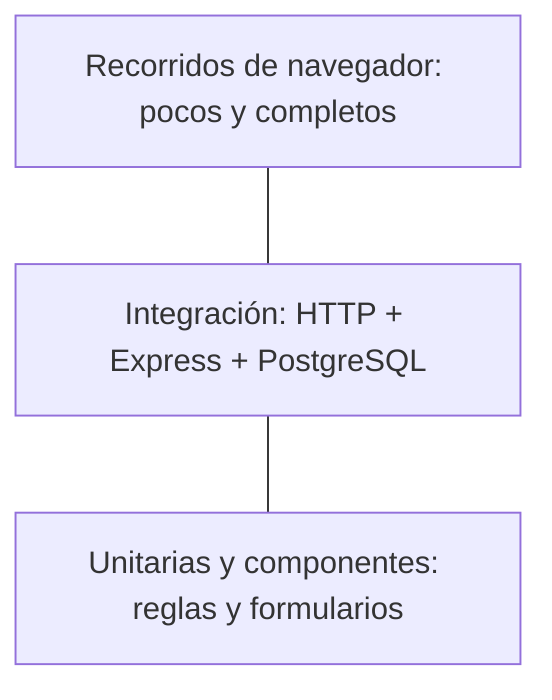

# Testing y pirámide de pruebas

## La idea que conviene explicar

La pirámide orienta a tener muchas verificaciones rápidas de reglas pequeñas, algunas pruebas de integración entre capas y pocos recorridos completos en navegador. No establece un porcentaje universal. Una prueba útil comprueba comportamiento y puede detectar una regresión; no se escribe solo para aumentar un número.



## Qué se prueba en este proyecto

| Nivel                   | Herramientas                     | Qué comprueba                                                                            | Qué no demuestra                                           |
| ----------------------- | -------------------------------- | ---------------------------------------------------------------------------------------- | ---------------------------------------------------------- |
| Reglas de backend       | Jest                             | Validación, normalización y autenticación con entradas válidas e inválidas               | Conexión HTTP o disponibilidad de PostgreSQL               |
| Componentes de frontend | Jest + Testing Library           | Validación del formulario, envío, errores y comportamiento visible                       | Funcionamiento de un navegador real o de la API desplegada |
| Integración de API      | Jest + Express + PostgreSQL real | Registro, login, contactos, estados, autorización y persistencia                         | Rendimiento de producción o todos los casos de interfaz    |
| Recorrido completo      | Verificación en navegador        | Crear cuenta, buscar, editar, cambiar estado, eliminar, recargar y usar la versión móvil | Una suite E2E de CI, salvo que se incorpore explícitamente |

El recorrido completo ya se revisó durante el desarrollo con un navegador automatizado. No se presenta como una suite Jest: son verificaciones distintas.

## Resultado local del 4 de noviembre de 2026

| Suite                                                                               | Pruebas que pasaron |
| ----------------------------------------------------------------------------------- | ------------------- |
| Backend: reglas, utilidades, configuración, middlewares aislados y contrato OpenAPI | 49                  |
| Backend: integración HTTP con PostgreSQL                                            | 22                  |
| Frontend: formulario y mensajes de error                                            | 10                  |

Estas 81 pruebas son evidencia de los escenarios automatizados actuales. No equivalen a una auditoría exhaustiva ni a una prueba de la aplicación publicada.

## Comandos

Desde `backend/`, con dependencias instaladas:

```bash
npm run test:unit
npm run test:integration
npm test
npm run test:coverage
```

Las pruebas unitarias se pueden ejecutar sin una base activa. Para integración se necesita una `DATABASE_URL` válida y las migraciones aplicadas:

```bash
npx prisma migrate deploy
```

Desde `frontend/`:

```bash
npm test
npm run test:coverage
```

Ambos proyectos también deben compilar:

```bash
npm run build
```

Jest permite separar proyectos/configuraciones y generar reportes de cobertura. La cobertura indica qué partes del código fueron ejecutadas por los tests; no garantiza que las aserciones sean suficientes ni que la aplicación no tenga fallas. [Configuración oficial de Jest](https://jestjs.io/docs/29.7/configuration).

La cobertura del backend está configurada sobre los schemas y las utilidades de contraseñas/JWT. La del frontend cubre `CustomerForm`, `Modal` y el módulo de mensajes de error. Un porcentaje alto de esos archivos no representa la cobertura de todos los controladores, el dashboard, el login ni el navegador. Revisá el alcance `collectCoverageFrom` junto al resultado.

En la ejecución local, los archivos seleccionados del backend alcanzaron 100% de líneas y 90% de ramas; los del frontend, 98,14% de líneas y 86,36% de ramas. Los umbrales configurados son 80% para líneas, sentencias y funciones, y 70% para ramas dentro de ese alcance.

## Cómo se protege la información durante las pruebas

La integración crea cuentas con emails temporales únicos. Los contactos de esas cuentas se eliminan por cascada al limpiar únicamente esos usuarios. La prueba no usa `deleteMany()` sin filtro para vaciar tablas ni reemplaza los datos de la cuenta de ejemplo.

Para automatizar la evaluación se recomienda una base exclusiva de pruebas. El workflow de CI prepara PostgreSQL temporal, aplica las migraciones, ejecuta Jest y compila. No requiere copiar el `.env` personal ni usar credenciales de producción.

## Casos que conviene mostrar al profesor

1. Una validación rechaza un nombre de contacto compuesto solo por espacios.
2. Un formulario conserva sus valores y muestra un mensaje si el servidor rechaza el guardado.
3. El recorrido de integración crea un contacto, lo consulta, lo actualiza y lo elimina.
4. Una cuenta no puede consultar, editar ni borrar el contacto de otra, aunque conozca su ID.
5. Un pedido con un `userId` extra no puede transferir la propiedad de un contacto.

No hace falta memorizar todos los tests. Conviene poder explicar qué riesgo cubre cada ejemplo y qué cambiaría si el test fallara.

## Integración continua y evidencia

La definición de GitHub Actions está en `.github/workflows/ci.yml`. La existencia del archivo demuestra configuración; un run verde en el repositorio remoto demuestra que se ejecutó allí. El [run #1](https://github.com/nicopelinski2001-a11y/CRM-ProgramacionWeb/actions/runs/41840228963) del commit `681c3a3` terminó en verde el 4 de noviembre de 2026: ambos jobs ejecutaron las pruebas, las compilaciones y las auditorías, y el backend aplicó las migraciones en PostgreSQL temporal.

CI comprueba automáticamente el código al recibir cambios. Desplegar es otro paso: publicar el backend y el frontend, configurar sus variables y verificar sus URLs. Un build local exitoso no reemplaza esa evidencia.
